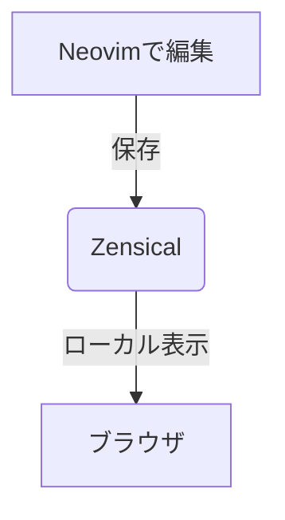

# サンプルMarkdown

## 見出しh2
### 見出しh3
#### 見出しh4
##### 見出しh5
###### 見出しh6

## 文字装飾
**太字** になります（または __太字__） <br>
*斜体* になります（または _斜体_） <br>
***太字＋斜体*** になります <br>
~~打ち消し線~~ になります <br>
==ハイライト==になります <br>
キーボードショートカットは ++ctrl+alt+delete++ です <br>

## 引用
> 引用文
> > 引用の中の引用

## 箇条書き
### 単純な箇条書き

- item 1 
- item 2
    * item 2-1
    * item 2-2
- item 3

### 数え上げの箇条書き

1. item 1 
2. item 2
    1. item 2-1
    2. item 2-2
3. item 3

### チェックボックス
- [x] 工程1
- [ ] 工程2
- [ ] 工程3

## 画像･リンク

Obsidian link: [[link_to]] <br>
URLリンク: [Google 検索エンジン](https://google.com) 


/// caption
画像に対する説明を記載できる <br>
改行も可能
///

{ align=left }

左の画像に対する説明を右側のテキストで説明することができる｡<br>
適宜改行しないと､下の `#!md ## 表` がここに表示されてしまう｡<br>
<br><br><br><br><br>

## 表

| 左寄せ | 中央揃え | 右寄せ |
| :--- | :---: | ---: |
| セル 1 | セル 2 | セル 3 |
| セル A | セル B | セル C |
| セル結合  | AAA | ~~ |
| __  | BBB | ~~ |

/// caption
表に対するキャプション
///

## コードハイライト
インラインのコードは `#!python print("Hello")` と記載する｡

コードブロック<br>
```c++ title="test.cpp"
#include <iostream>

using namespace std;

int main() {
    int n;
    cin >> n; // (1)!
    cout << "input: " << n << endl; // (2)!
}
```

<!-- コメントで記載した番号で注釈を付けられる -->
1.  :man_raising_hand: input!
2.  :smile: output!


mermaid は図を描画可能｡ <br>


## 区切り線
---
***

## 数式
インライン数式 $x=y$ <br>
ブロック数式 $$ x=y $$ 

## 絵文字

| コマンド | 絵文字 |
|:-:|:-:|
| `:smile:` | :smile: |
| `:fontawesome-regular-face-laugh-wink:` | :fontawesome-regular-face-laugh-wink: |

## タブ
=== "C"

    ``` c
    #include <stdio.h>

    int main(void) {
      printf("Hello world!\n");
      return 0;
    }
    ```

=== "C++"

    ``` c++
    #include <iostream>

    int main(void) {
      std::cout << "Hello world!" << std::endl;
      return 0;
    }
    ```

## カード
note, abstract, info, tip, success, question, warning, failure, 
danger, bug, example, quate のタイプがある｡

### グリッド
説明文なしのカード<br>
<div class="grid cards" markdown>

- :fontawesome-brands-html5: __HTML__ for content and structure
- :fontawesome-brands-js: __JavaScript__ for interactivity
- :fontawesome-brands-css3: __CSS__ for text running out of boxes
- :fontawesome-brands-internet-explorer: __Internet Explorer__ ... huh?

</div>

説明文ありのカード<br>
<div class="grid cards" markdown>

-   :material-clock-fast:{ .lg .middle } __Set up in 5 minutes__

    ---

    Install [`zensical`](#) with [`pip`](#) and get up
    and running in minutes

    [:octicons-arrow-right-24: Getting started](#)

-   :fontawesome-brands-markdown:{ .lg .middle } __It's just Markdown__

    ---

    Focus on your content and generate a responsive and searchable static site

    [:octicons-arrow-right-24: Reference](#)

-   :material-format-font:{ .lg .middle } __Made to measure__

    ---

    Change the colors, fonts, language, icons, logo and more with a few lines

    [:octicons-arrow-right-24: Customization](#)

-   :material-scale-balance:{ .lg .middle } __Open Source, MIT__

    ---

    Zensical is licensed under MIT and available on [GitHub]

    [:octicons-arrow-right-24: License](#)

</div>

タブ付きのカード
<div class="grid" markdown>

=== "Unordered list"

    * Sed sagittis eleifend rutrum
    * Donec vitae suscipit est
    * Nulla tempor lobortis orci

=== "Ordered list"

    1. Sed sagittis eleifend rutrum
    2. Donec vitae suscipit est
    3. Nulla tempor lobortis orci

``` title="Content tabs"
=== "Unordered list"

    * Sed sagittis eleifend rutrum
    * Donec vitae suscipit est
    * Nulla tempor lobortis orci

=== "Ordered list"

    1. Sed sagittis eleifend rutrum
    2. Donec vitae suscipit est
    3. Nulla tempor lobortis orci
```

</div>


### Admonition 
展開や畳むことができないカード｡

!!! note "Admonition (note)"

    note admonition


### Details 
展開や畳むことができるカード｡

??? tip "Details (tip)"

    最初は閉じているカード

???+ failure "Details (failure)"

    最初から開いていて畳むことができるカード

### インラインブロック
左に説明､右にカードを表示する｡ (とその逆)

=== ":octicons-arrow-right-16: inline end"

    !!! info inline end "Lorem ipsum"

        Lorem ipsum dolor sit amet, consectetur adipiscing elit. Nulla et
        euismod nulla. Curabitur feugiat, tortor non consequat finibus, justo
        purus auctor massa, nec semper lorem quam in massa.

    ``` markdown
    !!! info inline end "Lorem ipsum"

        Lorem ipsum dolor sit amet, consectetur
        adipiscing elit. Nulla et euismod nulla.
        Curabitur feugiat, tortor non consequat
        finibus, justo purus auctor massa, nec
        semper lorem quam in massa.
    ```

    Use `inline end` to align to the right (left for rtl languages).

=== ":octicons-arrow-left-16: inline"

    !!! info inline "Lorem ipsum"

        Lorem ipsum dolor sit amet, consectetur adipiscing elit. Nulla et
        euismod nulla. Curabitur feugiat, tortor non consequat finibus, justo
        purus auctor massa, nec semper lorem quam in massa.

    ``` markdown
    !!! info inline "Lorem ipsum"

        Lorem ipsum dolor sit amet, consectetur
        adipiscing elit. Nulla et euismod nulla.
        Curabitur feugiat, tortor non consequat
        finibus, justo purus auctor massa, nec
        semper lorem quam in massa.
    ```

